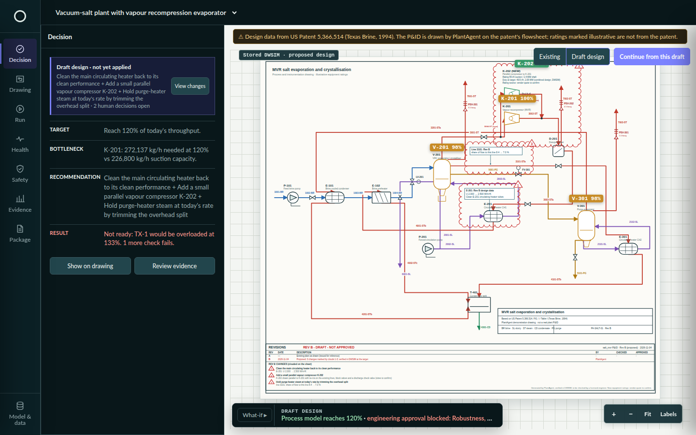
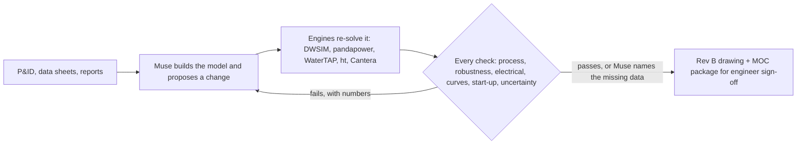

# PlantAgent: Muse proposes, physics checks, engineers approve

**An engineering workspace for changing an existing plant.** Meta's Muse reads the drawing and proposes the change; deterministic engines (DWSIM, pandapower and others) re-solve it; failed checks go back to Muse with their numbers; a human approves. Built from zero during the Meta Global AI Developer Hackathon, Oct 26 – Nov 4, 2026 · Indie developer · Push the Frontier · targeting Best Agentic Use-Case and Best Build on Meta Open Weight Models (Muse Spark Open runs the engineering loop, on Baseten and Fireworks).



**Try it:** hosted replay, no credentials: https://plantagent.63-182-151-178.sslip.io · or locally:

```bash
git clone https://github.com/yigitcankzl/plant-agent.git && cd plant-agent && ./start.sh
# open http://127.0.0.1:8765/home.html  (stored runs need no API key and no engineering engine)
```

## What it showed

| | Result | Evidence |
|---|---|---|
| **Live loop** | On BASF's official DEXPI example, Muse Spark Open ran 4 rounds from a neutral goal: the simulator rejected 2 designs (product quality, then flooding on a high-feed day); high-capacity trays then passed every modelled check. 15 min, $1.41. Tray rating: vendor to confirm. | [worklog](runs/ws/basf_process_column_k_2750_dexpi_c02_uns/work/20261103-214753/worklog.json) |
| **Red team** | A second model, Muse Spark 1.3, attacked that design with 8 bounded operating deviations; DWSIM re-solved each: 8 / 8 held, worst 93 % of the flood limit. | [redteam_trays.json](runs/ws/basf_process_column_k_2750_dexpi_c02_uns/redteam_trays.json) |
| **Real plant, blind** | From Shell Norco's pre-revamp data only, Muse chose the same revamp type Shell built: high-capacity trays in the existing column. Against Shell's measured after-data: 5 match, 3 partial, 1 miss, 1 not predicted. | [real-plant-norco](evidence/real-plant-norco/README.md) |
| **Cross-discipline** | On a salt plant the process target passed at 120 %, but an illustrative transformer rating reached 133 %, so approval stays blocked. | [salt gates](runs/ws/salt_mvr/gates.json) |
| **Open weights** | On the 2006 European blackout grid the hosted endpoint was blocked by content policy; Muse Spark Open completed the checked loop with 0 N-1 violations. | [open-weights](evidence/open-weights-engineering/README.md) |

Honest denominator: 21 of 69 recorded loop runs ended with every deterministic check passing ($192 in total), and most of those still carry an open vendor or human check (`tools/loop_stats.py`).

## How it works



| Meta model | Its job in PlantAgent |
|---|---|
| **Muse Wonder** | Reads drawings (DEXPI, scanned PDF, patent figure) and drafts the first simulator model |
| **Muse Spark Open** (open weights, Baseten and Fireworks) | Runs the engineering loop: proposes changes, reads the failed checks, revises |
| **Muse Spark 1.3** | Attacks a passing design with operating deviations (red team); answers questions on the page |
| **Muse Voice Transcribe** | Turns the engineer's spoken goal into text |

The language model never decides pass or fail: the engines' check rows do, and only an engineer approves. The `openai` package is only the transport SDK for these OpenAI-compatible endpoints; no OpenAI model is called.

## Limits

- Screening, not design: DWSIM is steady state, costs are AACE Class 5, and there are no vendor curves, rigorous dynamics, HAZOP or relief sizing. Everything is a draft for a licensed engineer.
- Values a source does not give are labelled illustrative or synthetic where they appear (for example the salt transformer rating and historian).
- A new equipment rating proposed by Muse (such as a tray capacity factor) stays open for vendor confirmation.
- Full caveats of each result: [docs/limits.md](docs/limits.md).

## More

- Every case in full: [docs/highlights.md](docs/highlights.md) and [docs/cases.md](docs/cases.md)
- Running live calls, the engines, clean-clone behaviour and access control: [docs/running.md](docs/running.md). `./start.sh --live` asks privately for your own `META_API_KEY`.
- Tests: `.venv/bin/python -m unittest discover -s tests` (about 5 min; engine-dependent tests skip without DWSIM)
- Timeline: kickoff Oct 26, 2026, 12:00 PM ET; first stored run Oct 27, 01:53 Istanbul time; no PlantAgent code existed before the kickoff. The git history shows the order of the work.
- Data sources and credits: [docs/credits.md](docs/credits.md)

## License

MIT, see [`LICENSE`](LICENSE). Engines, libraries and the cited source documents keep their own licenses.
