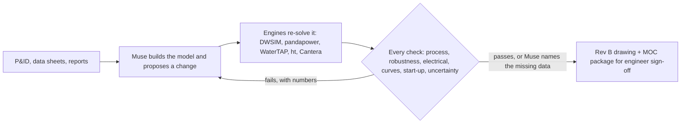

# PlantAgent: Muse proposes, physics disposes

**Give it a change to an existing plant. Meta's Muse builds the simulator from the drawings and designs the change; deterministic engineering engines check every round; failed checks go back to Muse with their numbers; the engineer gets the marked-up drawing and a change package to sign.** The AI is not trusted, it is checked.



Hackathon theme: **Push the Frontier** (manufacturing and energy). Built on Muse Spark, Muse Wonder and Muse Voice Transcribe (Meta API) and Muse Spark Open (open weights, on Baseten and Fireworks).

**In one minute**
- **The agent is checked, and refused.** Muse's first fix on the BASF column (cut reflux) passed the checks of the time; the product-purity check we added next fails it on replay (90.3 vs 90.8 %). With that check in the loop, Muse's next design failed the +10 % feed case, the numbers went back to Muse, and its following design (a 600 mm shell, vendor to confirm) passed every deterministic simulation check. A second Muse then attacked that design with eight realistic bad days (hot feed, fouled trays, low pressure); DWSIM refereed and the design held **8 of 8** (worst case 90 % of the flood limit).
- **Open weights did what the hosted endpoint would not.** On the 2006 European blackout grid, Meta's hosted endpoint refused the prompt four times; Muse Spark Open ran the same loop and found a switching plan with **0 N-1 violations**.
- **A real plant, blind.** Given only Shell Norco's pre-revamp operating data (paper title withheld, no earlier answers), Muse re-trayed the same C2 splitter shell, as Shell did: round 1 failed the +10 % feed case, round 2 passed every simulation check at the +25 % ethylene target the project was given (Shell measured +25 %). Asked with no documents, all three Muse models say they do not know what Shell did.
- Honest denominator: Under a third of recorded loop runs end with every deterministic check passing (21 of 69 on 3 Nov, $192 in all; most "done" runs still carry open vendor or human checks; the live count is `tools/loop_stats.py`). Every caveat is under [Limits and honesty](#limits-and-honesty).

**Hosted replay (no credentials):** https://plantagent.63-182-151-178.sslip.io

```bash
git clone https://github.com/yigitcankzl/plant-agent.git
cd plant-agent
./start.sh
# open http://127.0.0.1:8765/home.html — stored runs need no API key or engineering engine
```

For live Meta Model API calls, run `./start.sh --live`: it asks privately for **your own** `META_API_KEY`, does not save it,
and enables live actions with a $5 spend cap. Alternatively, copy `.env.example` to the gitignored `.env`, set
`META_API_KEY`, and run the same command. Restart the server after changing `.env`.
The key enables Muse calls; fully re-solving a new process or grid design also needs the corresponding engine listed
under [Engines](#engines-for-asking-building-and-applying-changes-plus-a-muse-key-in-env). Replay remains available without them.

## What it has done
- **The engineering loop** (`plantagent/loop.py`): the engines re-solve Muse's design and run every check (process, robustness, electrical, compressor curves and surge, start-up transient, uncertainty; limits and N-1 for grids). Failed checks go back to Muse with their numbers until everything passes or Muse says why it cannot. Every round is logged with who did what.
- **Deterministic engines** (DWSIM, WaterTAP, EPANET, pandapower, ht/fluids, Cantera) re-solve every proposal before it can be applied; a change that only edits a limit is refused.
- **Not only our demos.** An official DEXPI drawing we had never used (BASF column C02), with no hand-written case file: Muse built the DWSIM column and found it floods first at +13 % ($1.54 on open weights). Its first fix, a reflux cut to 0.8, fails the purity check added afterwards (minimum reflux 1.10); a 600 mm shell then gave **simulation checks passed**, vendor confirmation open. [Below](#basf-c02-the-loop-then-the-red-team).
- **A second model attacks the design** (`plantagent/redteam.py`): Muse Spark 1.3 proposes credible operating deviations within the +10 % envelope band, and DWSIM re-solves each one. BASF's 600 mm design held **8 of 8** attacks (worst flood 90 % of the limit; $0.13). [Evidence](evidence/redteam/README.md).
- **A real plant, blind.** Shell's Norco C2 splitter before its 2015 revamp, outcome withheld. Muse Spark Open re-trayed the same shell, as Shell did: **round 1 failed** the +10 % feed case, **round 2 passed** every simulation check ($4.30). Against Shell's measurements: 5 match, 3 partial, 1 miss, 1 not predicted. [Below](#a-real-plant-blind-shell-norco-c2-splitter).
- **Open weights in the loop.** Muse Spark Open on Baseten: on UCTE, where the Meta-hosted endpoint refused the prompt four times (content policy), it found a switching plan that passes line limits and N-1; on Freeport it matched Muse Wonder; on the salt plant neither model finished. [Below](#open-weights-the-2006-european-blackout).
- **The engineer's red pen** (`web/redline.html`, `plantagent/redline.py`): Muse Wonder reads the red ink on an uploaded drawing into changes, the engineer confirms them, and the same checks run on the engineer's design and Muse's side by side. First live read (salt, typed notes): 3 of 3 transcribed, 1 mapped. [Evidence](evidence/redline/README.md).
- **The honest denominator.** Across all 69 recorded engineering-loop runs during development (3 Nov, including the discarded first revamp-benchmark runs), 21 (30 %) ended with every deterministic check passing ($192 in total); most of those still carry an open vendor or human check. Each featured run is the last of several attempts, with harness fixes between them in the git log. Table: `PYTHONPATH=. python tools/loop_stats.py`.
- Blind benchmark: on 13 real projects with the engineers' conclusions withheld, Muse reaches **64 %** of the engineers' conclusions on average (range 33–100 %), graded by Muse Wonder against a fixed answer key, not by a person. [Details](docs/cases.md#evidence-blind-benchmark-against-real-engineers).

The full, unshortened list (including the salt flagship and the two incidents) is in [docs/cases.md](docs/cases.md#full-what-it-has-done-list).

| Muse does | The deterministic engines do |
|---|---|
| Reads P&IDs (DEXPI or PDF), data sheets, reports and photos | Solve the model: DWSIM (process, and trapped liquid along an isochore), WaterTAP (RO), EPANET/WNTR and TSNet (water), pandapower (grids), a gravity profile solver |
| Builds the simulator model and its calibration table | Re-solve every proposal and the combined design on the server before it can be applied |
| Plans the study, chooses which runs to make, proposes the changes | Check limits, relief paths (`pid.relief_scan`), the electrical load flow (pandapower), exchanger detail (ht/fluids) and combustion (Cantera) |
| Writes the answer and drafts the deliverables | Decide pass/fail on the discipline gates; citations and cited runs are checked without an LLM |

> Draft engineering output for review by a licensed professional engineer. It is not a substitute for one.

## Try it in three minutes

With the server running (above), open `http://127.0.0.1:8765/home.html` and press **Open the engineering desk**. It opens the salt crystalliser (`plant.html?case=salt_mvr&tour=1`) and walks through it in six steps: the source P&ID and the model Muse built from it; the +20 % question; what limits it; the fixes, each re-solved in DWSIM; before and after; the evidence.

Then open the BASF column card (`plant.html?case=basf_process_column_k_2750_dexpi_c02_uns`): a drawing the tool had never seen, with no hand-written case file.

Then open the two incident rows on the home page, `plant.html?case=ucte_2006` and `plant.html?case=freeport_lng_2022`. Drag the slider: grid transit for UCTE, hours blocked in for Freeport. Then open **Compare with the recorded decision**.

On the salt plant, look at:
- **Existing / Proposed** above the drawing: Rev B of the P&ID with the changes clouded.
- **Engineering impact**: one gate per discipline. Click a gate to see its checks and their sources.
- **Decision / Engineering**: the short decision, or the full calculations, alternatives, sources and audit.
- **Issue engineering package**: the MOC pack, pre-FEED gate, vendor RFQ duty sheet and commissioning plan.

## BASF C02: the loop, then the red team

`plant.html?case=basf_process_column_k_2750_dexpi_c02_uns`: the official DEXPI example C02 Process Column (BASF), unmodified, run through the upload path with no hand-written case file (`tools/onboard_unseen.py`).
- **Answer:** the column floods first: it reaches its 80 % flood allowance at +13 % of today's feed (reflux 1.5).
- **Loop 1:** cut reflux to 0.8; it passed the checks of the time. The purity check added afterwards fails it on replay (distillate ethanol 90.3 vs 90.8 % minimum). **Loop 2:** reflux 1.5 and a larger bottoms draw; everything passed except the +10 % feed case. **Loop 3:** a 600 mm shell (vendor to confirm): flooding 60.8 vs 80 %, purities pass, envelope 2/2, target held in 100 % of 48 uncertainty re-solves. $8.39 in total, all on Baseten.
- **Red team:** eight bounded attacks from Muse Spark 1.3, each re-solved by DWSIM; the design held 8 of 8. A harsher, unrealistic stacked set broke it, and the loop answered with a 700 mm shell (see caveats).
- Record: [docs/cases.md](docs/cases.md#an-unseen-drawing-no-hand-written-files), [`evidence/generality-c02/`](evidence/generality-c02/README.md), [`evidence/redteam/`](evidence/redteam/README.md). The duty is Muse's assumption and the drawing already holds a 600 mm section; see [caveats](#caveats-of-the-headline-results).

## A real plant, blind: Shell Norco C2 splitter

`plant.html?case=shell_norco_c2splitter`: given Shell Norco's published pre-revamp operating data; the revamp, the after data and the paper's title are withheld, and the run starts with no earlier answers. Asked with no documents, all three Muse models say they do not know what Shell did ([probe](evidence/real-plant-norco/closed_book_probe.json)).
- Muse Spark Open re-trayed the same shell, as Shell did. Round 1 failed the +10 % feed case; with those numbers, round 2 passed every simulation check: ethylene 1.25x (the server verified at today's 62.4 wt % feed composition; Muse's own runs at the 69 wt % premise gave 77 % of flood), 74 % of flood (85 % allowed), purity, minimum reflux, 48 of 48 uncertainty samples.
- Against what Shell measured: 5 match, 3 partial, 1 miss (the feed-tray move), 1 not predicted ([scorecard](runs/ws/shell_norco_c2splitter/comparison.json)).
- Record: [`evidence/real-plant-norco/`](evidence/real-plant-norco/README.md). The flood result rests mostly on Muse's assumed tray capacity; see [caveats](#caveats-of-the-headline-results).

## Open weights: the 2006 European blackout

`plant.html?case=ucte_2006` rebuilds the German 380 kV grid around Landesbergen from the UCTE Final Report (2007), stopping at the 22:08 request to couple two busbars. Blind, Muse found the coupling raises the tripping line 1,779 → 1,831 A instead of relieving it, as the report found.
- In the engineering loop the Meta-hosted endpoint rejected four attempts on content policy (not a quality result). **Muse Spark Open** on Baseten ran the same loop: redispatch + open the BIO-SPX 220 kV tie; line limits pass and N-1 has **0 violations**, in one independent paid run ($1.73).
- Record: [`evidence/open-weights-engineering/`](evidence/open-weights-engineering/README.md) and [docs/cases.md](docs/cases.md#incident-1-the-2006-european-blackout-power-grid). Loop evidence, not a controlled benchmark.

**More cases**, verbatim with their limits, in [docs/cases.md](docs/cases.md): the salt crystalliser flagship, the scanned 1994 patent read, Freeport LNG, NREL cellulosic ethanol, the second opinion, the 2008 pilot decision, the blind benchmark, the workspace features, under the hood, and the roadmap.

## Limits and honesty

### Caveats of the headline results
- **Norco (real plant):** the flood result follows mostly from Muse's assumed tray capacity (factor 1.85, vendor to confirm; Muse's own sweep put the minimum near 1.80), the uncertainty run varies other inputs but not that factor, and Muse names generic high-capacity tray vendors as examples; the model's distillate ethane is 0 ppm where the plant ran at 487 ppm, so separation was matched to hydraulics, not to the product analysis, and the reflux margin is optimistic; the server verified the design at today's feed composition; the 69 wt % premise appears only in Muse's own runs; the feed-tray move was missed; and Muse's text cites the paper and tray vendors, so training-data exposure is possible. Earlier runs reported a 65 % flood "match" with Shell's 64.7 % under a flow scaling we have since corrected; we withdrew it. Details: [`evidence/real-plant-norco/`](evidence/real-plant-norco/README.md).
- **BASF C02:** The column's duty is Muse's assumption (the drawing gives none), and the drawing already contains a 600 mm column section (KX 2750) next to the 500 mm chamber, so the 600 mm shell is less of a discovery than it looks. This case shows the drawing-to-simulator path works; it does not show Muse found a real plant's bottleneck.
- **Red team:** A harsher stress set (1.25x the target with two or three deviations stacked, beyond any credible single-jeopardy case) broke it 8 of 8 (flood 116–118 %); the loop answered with a 700 mm shell and ended done ($1.59), which is over-design against an unrealistic attack, shown only to demonstrate the loop. Temperatures now move by at most ±15 °C, not a percentage of °C.

### General

- **Illustrative and synthetic inputs are labelled where they appear.** Labelled data includes:
  - the chem_c01 data sheet;
  - salt ratings the patent does not give, and its one-line diagram;
  - the salt historian, which is **SYNTHETIC**;
  - fouling prices;
  - RO membrane coefficients.
- **The model's calibration table** compares measured values with the solved model. Some of those values are model inputs, and the table marks which.
- **"Verified" means process-verified.** Other disciplines are shown next to it as gates, and an electrical or robustness fail is never hidden by a process pass.
- **DWSIM is steady state.** Valve and pipe calculations are incompressible-liquid screens. The solve scales exchanger U from one test point; the ht/fluids check computes U from geometry and flags any disagreement.
- **Surge is a pre-screen.** TSNet has no pump inertia or column separation.
- **The gravity profile has no open-channel step method.**
- **Costs are AACE Class 5, with no contingency.**
- **Drafted discipline files are screening values.** Their check rows say "draft (assumed values)"; the start-up check uses typical inertia and load curves until vendor data is uploaded.
- **No vendor curves, no rigorous dynamics, no multidisciplinary HAZOP, no relief sizing.** Everything PlantAgent produces is a draft for a licensed engineer.

## Run it

```bash
./start.sh                                      # replay, no key
./start.sh --live                               # privately prompts for your own Meta key
.venv/bin/python -m unittest discover -s tests       # the test suite (~5 min; engine-dependent tests skip without DWSIM)
.venv/bin/python -m plantagent.study --case roseburg   # a full blind study (about 20 min, $0.05–0.64)
```

The `openai` package in `requirements.txt` is only the transport SDK for the OpenAI-compatible Meta, Baseten and Fireworks endpoints; PlantAgent calls no OpenAI model.

**From a clean clone, with no API key and no separately installed engines** (tested in `python:3.12-slim` with an empty `$HOME`; the requirements still install numerical Python libraries)
- Works from the stored results: `home.html`; `plant.html?case=salt_mvr` and its guided tour (`&tour=1`); `ucte_2006`; `freeport_lng_2022`; `nrel_ethanol_a300` and `nrel_ethanol_a500`; `basf_process_column_k_2750_dexpi_c02_uns`; `chem_c01`; `swro_brownsville`; `swro_monterey`; `dairy_refrig`; and the `index.html` blind-study replays. The throughput slider replays precomputed **existing-plant** solutions. Proposed designs without a stored proposed-state file are labelled as unavailable and show today's plant; re-solving them needs the named engine.
- The project-drawn P&IDs ship in `cases/<case>/pid.xml`. The DEXPI examples C01 and C02 ship under CC BY 4.0 (`DEXPI-NOTICE.md` in each case).
- Public source PDFs are not redistributed; their URLs are in `cases/*/case.json`. Cases that read them (roseburg, stpete_swwrf, edgebrook, dc_iitk) need `PLANTAGENT_DATA_ROOT` pointing at the downloaded files (default `../case-data` next to the repo) and `poppler-utils` (`pdftotext`, `pdftoppm`).
- Stored replay is read-only usage: Ask is disabled, while applying changes, arbitrary what-ifs and issuing a new engineering package need the engines. Some of those controls remain visible and report the missing engine when used. The Proposed drawing can still be selected while the verdict labels its loads as today's plant. The vision case uses a labelled placeholder when its public patent scan is absent. Browser results and remaining limits: [`evidence/clean-clone/`](evidence/clean-clone/README.md).

**Engines, for asking, building and applying changes** (plus a Muse key in `.env`)
- DWSIM 9 under `~/opt/dwsim/usr/local/lib/dwsim` and .NET 8 under `~/opt/dotnet` (paths in `plantagent/process.py`).
- pandapower in its own venv: `uv venv .venv-electrical --python 3.12 && uv pip install --python .venv-electrical -r requirements-electrical.txt`.
- pyDEXPI in its own venv, so an uploaded DEXPI P&ID is drawn as SVG (Rev B clouds on new plants): `uv venv .venv-pid --python 3.12 && uv pip install --python .venv-pid pydexpi` (or set `PID_RENDER_PYTHON`).
- WaterTAP in its own venv: `python3 -m venv .venv-watertap && .venv-watertap/bin/pip install -r requirements-watertap.txt`.
- Optional: ODA File Converter (DWG), LibreCAD, and `.venv-surge` with TSNet.

**Money and access**
- Muse spend is capped by `MUSE_BUDGET_USD` and logged in `runs/usage.jsonl`.
- The page header's **AI cost** is the Muse spend of the questions on record for that case. Model builds are listed separately on the case.
- Muse-spending actions are disabled unless `WEB_ALLOW_RUNS=1`.
- The server binds to localhost by default. A non-local `--host` requires `WEB_AUTH_TOKEN`, and writes need `WEB_ALLOW_WRITES=1`.
  The stock browser UI does not send the bearer header, so a remote deployment needs a reverse proxy that adds it.
  POSTs must be same-origin `application/json` (form and cross-site posts are refused), and a local server only answers its own host name.
- One server process is for one trusted team/project: workspaces and jobs are process-local and are not tenant-isolated. Separate deployments are required for unrelated users.

## Timeline

Built during the hackathon window. Kickoff was Oct 26, 2026 at 12:00 PM ET. The first stored run is from Oct 27 at 01:53 Istanbul time (`runs/20261027-015311`); the first commit is from Oct 27 at 10:42. No PlantAgent code existed before the kickoff; the first commits batch the local work started at 01:53 on Oct 27. DWSIM, pandapower, WaterTAP, EPANET/WNTR, ht/fluids and Cantera are external open-source libraries. The git history shows the order of the work.

## Data and credits

The public documents are not redistributed; download them from the URLs in `cases/*/case.json`:

- City of Roseburg 2009 PDR
- St. Petersburg SWWRF 2014
- Battle Creek IFB 2023-040B
- Canal & River Trust / Green WIN audits
- GLWA, CSB, Stanislaus RWA and LBNL reports
- BattLeDIM 2020 (CC BY 4.0)
- CSB Williams Geismar case study (2016)
- DEXPI e.V. TrainingTestCases (reference P&ID C01 and C02 Process Column by BASF, CC BY 4.0, shipped unchanged)
- US Patent 5,366,514 (Texas Brine)
- Brownsville PUB / TWDB seawater desalination feasibility study (2004) and pilot report (2008)
- US DOE ITAC/IAC database
- NETL 2022 baseline report

Field photos are from Wikimedia Commons (De Laval pump label by Loozrboy, CC BY-SA 2.0; standpipe gauge by Mark Cross, CC BY 4.0; others are listed in `case-data/raw/field_photos/SOURCE.txt`).

Cost curves: TWDB 2024, City of Phoenix 2024, US EPA WBS, EPA-600/2-79-162b. Design rules: Recommended Standards for Water Works (2022) and Wastewater Facilities (2014).

## License

MIT, see [`LICENSE`](LICENSE). Engines, libraries and the cited source documents keep their own licenses.
