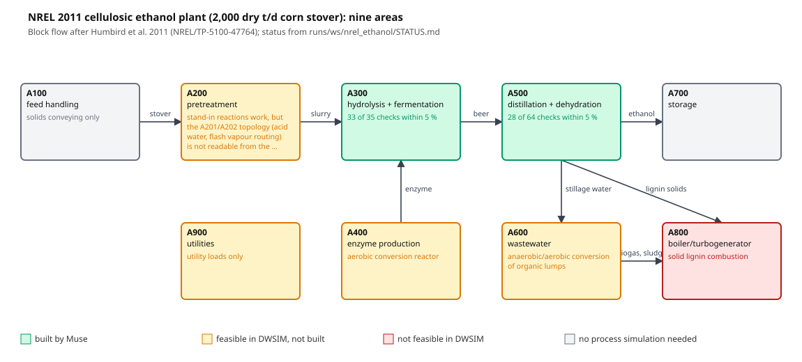
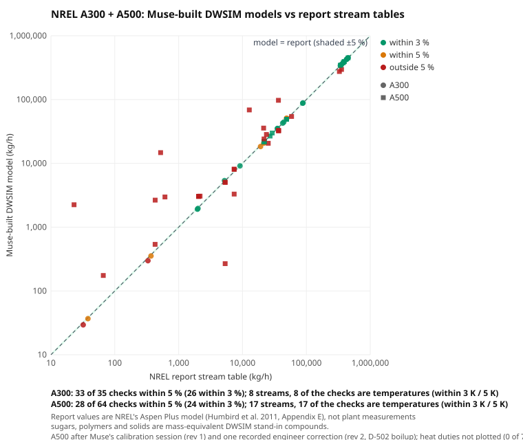

# PlantAgent: more cases and details

Moved here from the [README](../README.md) so its first screen stays short. Nothing below was shortened; links are fixed to resolve from `docs/`. All caveats are also in [Limits and honesty](../README.md#limits-and-honesty).

## Full "What it has done" list

The README keeps a shortened version of this list. The original bullets, verbatim:

- **The engineering loop** (`plantagent/loop.py`): the engines re-solve Muse's design and run every check (process, robustness, electrical, compressor curves and surge, start-up transient, uncertainty; limits and N-1 for grids). Failed checks go back to Muse with their numbers; Muse fixes them; repeat until everything passes or Muse says why it cannot. Every round is logged with who did what.
- Deterministic engines (DWSIM, WaterTAP, EPANET, pandapower, ht/fluids, Cantera) re-solve every proposal before it can be applied; a change that only edits a limit is refused.
- Flagship: a vacuum-salt MVR crystalliser reaches **+20 %** with three verified changes (clean E-201, a parallel compressor K-202, a purge-steam trim), found in the Ask workspace with the engineer's hint to add K-202. The automatic loop has not closed this case: in 9 runs it either ran out of budget or steps, or stopped and named the missing vendor compressor curve (the featured run). The discipline gates then flag what the process answer alone hides: **TX-1 overloaded (~133 %)** and **not robust when E-201 re-fouls**.
- The same loop works outside process plants. Two real incidents, rebuilt by Muse from the investigation reports with the conclusions withheld:
  - **UCTE 2006 European blackout** (pandapower): coupling the Landesbergen busbars raises the tripping line 1,779 → 1,831 A; the reduced grid remains insecure under three other single outages.
  - **Freeport LNG 2022** (DWSIM, trapped liquid): a blocked-in LNG line with its relief isolated bursts in days; restoring PSV-101 is screened at an ideal relief boundary, with capacity unchecked.
- **Not only our demos.** An official DEXPI drawing we had never used (BASF column C02) went through the upload path with no hand-written case file: Muse built the DWSIM column, the discipline files were drafted, an engineer confirmed three assumptions, and Muse found the column floods first at +13 % ($1.54 on open weights). Its first no-capex fix, cutting reflux to 0.8, was failed by the product-purity check we added (minimum reflux 1.10). In the next loop Muse kept reflux at 1.5 and raised the bottoms draw: everything passed except the +10 % feed case. Once replacing equipment became verifiable, Muse proposed a 600 mm shell and the loop ended with **simulation checks passed**; the vendor's confirmation remains open, so it is not engineering approval. The column's duty is Muse's assumption; caveats under [Limits](../README.md#limits-and-honesty).
- **A real plant, blind.** Shell's Norco C2 splitter before its 2015 revamp, from the published operating data; the revamp, the after data and the paper's title are withheld, the run starts with no earlier answers, and asked with no documents all three Muse models say they do not know what Shell did ([probe](../evidence/real-plant-norco/closed_book_probe.json)). Muse Spark Open re-trayed the same shell, as Shell did. **Round 1 failed** the +10 % feed case; the numbers went back to Muse; **round 2 passed** every simulation check ($4.30): ethylene 1.25x (the server verified at today's 62.4 wt % feed composition; Muse's own runs at the 69 wt % premise gave 77 % of flood), 74 % of flood (85 % allowed), purity, minimum reflux, 48 of 48 uncertainty samples. Against what Shell measured: 5 match, 3 partial, 1 miss (the feed-tray move), 1 not predicted ([scorecard](../runs/ws/shell_norco_c2splitter/comparison.json)). Caveats under [Limits](../README.md#limits-and-honesty).
- **A second model attacks the design** (`plantagent/redteam.py`). After a design passes, Muse Spark 1.3 proposes credible operating deviations (hot or cold feed, low pressure, fouled trays compensated with reflux, composition swings) within the +10 % envelope band, and DWSIM re-solves each one. BASF's 600 mm design held **8 of 8** attacks (worst flood 90 % of the limit; $0.13).  Records: `runs/ws/basf_process_column_k_2750_dexpi_c02_uns/redteam_600mm.json` and `work/20261102-203128/`.
- **The engineer's red pen** (`web/redline.html`, `plantagent/redline.py`). Upload a marked-up drawing; Muse Wonder reads the red ink into changes, the engineer confirms them, and the same checks run on the engineer's design and Muse's side by side. First live read on the salt drawing (typed red notes, not handwriting): all three notes transcribed; one mapped, two left unmapped because the ink gave no connections or setpoint. Cleaning E-201 alone reaches 100 % (the compressor limits); Muse's design reaches 120 % but overloads TX-1. Details: [`evidence/redline/`](../evidence/redline/README.md).
- **Open weights in the loop.** Muse Spark Open on Baseten ran the same engineering loop: on Freeport it reached the same conclusion as Muse Wonder; on UCTE, where the Meta-hosted endpoint refused the prompt four times (content policy), it found a switching plan that passes line limits and N-1; on the salt plant neither model finished, and the page says so.
- Blind benchmark: on 13 real projects with the engineers' conclusions withheld, Muse reaches **64 %** of the engineers' conclusions on average (range 33–100 %), graded by Muse Wonder against a fixed answer key, not by a person.
- **The honest denominator.** Across all 61 recorded engineering-loop runs during development (3 Nov, including the discarded first revamp-benchmark runs), 14 (23 %) ended with every deterministic check passing ($182 in total); most of those still carry an open vendor or human check. Each featured run is the last of several attempts on its case, and the harness was fixed between attempts (each fix is in the git log). The full table: `PYTHONPATH=. python tools/loop_stats.py`.

## Flagship: salt crystalliser, one change checked across disciplines

`plant.html?case=salt_mvr` is a vacuum-salt plant with a mechanical vapour recompression (MVR) evaporator. It is built from **US Patent 5,366,514** (Texas Brine, 1994), FIG. I and Table I.
- PlantAgent drew the P&ID tags, line numbers and relief settings on the patent's flowsheet.
- Equipment ratings the patent does not give are marked ILLUSTRATIVE.

**Model**
- Muse (muse-wonder-1.0) built the DWSIM model in 1,096 s for $4.03.
- The brine boiling-point elevation (Sparrow 2003) and the brine heat capacity (Laliberte, via WaterTAP) are applied explicitly in `plantagent/brine.py`, because DWSIM's NRTL has no electrolyte parameters.
- The automatic model review caught three modelling errors: a free steam feed, a vapour feed to the purge evaporator, and a free circulation feed. Each was fixed as a recorded correction revision (`runs/ws/salt_mvr/revisions.json`).
- The model is calibrated to Table I: 226.8 t/h to the compressor K-201.

**+20 % salt**
- The first limit is K-201 suction.
- The verified design has three changes:
  - clean E-201 back to its clean U;
  - add a parallel vapour compressor K-202, operating at 49.5 t/h and 2.05 MW in the combined solve, with a provisional rating of 55 t/h / 2.4 MW for the vendor to confirm;
  - trim the purge-heater steam.
- DWSIM re-solves the combination at 120.1 %.
- **Where K-202 came from.** Muse's first answer proposed raising K-201's rating, and the server refused it because a change that only edits a limit is not accepted. The engineer then asked for a physical change and named a parallel compressor (answer 2 in `runs/ws/salt_mvr/`); the verified design builds on that. In a clean session with no earlier answers (`salt_mvr_vision`, model built from the scanned patent figure), Muse did not propose a second compressor and did not reach 120 %. So the K-202 idea is the engineer's; the sizing, the re-solve and the consequences are the agent's and the engines'.
- From the solve PlantAgent draws Rev B of the P&ID (new lines 3004-ST and 3005-ST, block and check valves on K-202) and writes the data sheet, work order, summary and MOC pack.

**Discipline gates on the same change** (`prefeed.discipline_gates`). Each gate reads a solved state, not LLM text, and each check names its source. A gate that rests on an illustrative rating says so: the electrical ✕ below is a pandapower result against an ILLUSTRATIVE 2.5 MVA TX-1, so it means "check the real transformer", not a measured overload.

| Gate | Result | From |
|---|---|---|
| Process | ✓ reaches 120 % | DWSIM re-solve of the combined changes |
| Robustness | ✕ 3 of 4 operating scenarios pass; fails with E-201 fouled back | DWSIM, pre-FEED operating envelope |
| Mechanical | ○ K-202 within its provisional rating; vendor curve needed | solve vs rating |
| Electrical | ✕ TX-1 45 → ~133 %, 29 % start dip direct-on-line; a VFD fixes the dip, not the transformer | pandapower on an illustrative one-line diagram |
| Heat transfer | ○ E-201 needs 7,130 of 8,800 m² clean; pump and shell-side ratings illustrative | ht/fluids (Gnielinski, Bell-Delaware) |
| Combustion | ○ +20 % steam needs about 10.1 MMBtu/h (3.0 MW) of duct firing on the proposed design | Cantera GRI-Mech 3.0 |
| Piping, controls, safety, civil | ○ no calculation adapter; listed as open work | change register |

The MOC pack carries the failed gates as risks and its decision reads "Do not approve yet".

**Fouling forecast** (`plantagent/forecast.py`, no LLM)
- It fits E-201's U from the historian.
- It then bisects the model for the U at which the first limit reaches 100 % at today's throughput.
- The historian is **SYNTHETIC** and the prices behind the daily loss are **illustrative**.

## Muse reads the scanned 1994 patent figure

`plant.html?case=salt_mvr_vision` gives Muse vision the patent's scanned FIG. 1 (a sideways sheet with no text layer) instead of our drawn P&ID.
- It found all 13 labelled equipment items with their reference numbers. One was misclassified: the brine preheater was read as a pump.
- About 13 of its 20 connections were right. The engineer review made 9 corrections, including a shaft read as a stream and three missing streams. Muse's original read and the corrections are stored separately (`runs/ws/salt_mvr_vision/pid_read.json`, `pid_confirmed.json`).
- The DWSIM model Muse built from it is heat-limited at 92 % after one recorded correction, so it is not calibrated to the patent's 100 %. The flagship keeps the drawn P&ID.

## Incident 1: the 2006 European blackout (power grid)

`plant.html?case=ucte_2006` rebuilds the German 380 kV grid around Landesbergen on the evening of 4 November 2006 from the UCTE Final Report (January 2007). At 22:08 the dispatchers asked to couple two busbars at Landesbergen, expecting the Landesbergen-Wehrendorf current to fall.
- Muse (muse-wonder-1.0) built the reduced pandapower network and calibrated it to the report's Fig. 30. Reactances the report does not give are marked ILLUSTRATIVE.
- `basis.md` stops at the 22:08 request. The investigators' simulation and conclusion are in `cases/ucte_2006/outcome.json`, which the agent never sees.
- **Muse's blind answer:** "No relief — coupling raises line current". The line goes from 1,779 to 1,831 A, past the 1,795 A warning, and the N-1 screen on the coupled grid is not secure.
- **What the report found:** current rose by about 67 A instead of falling, distance protection tripped the line, and the grid split into three areas. It had not been N-1 secure since Conneforde-Diele was switched off.
- **Limit:** the model gives +52 A against the report's +67 A. It puts the line at 1,831 A, 87 % of the 2,100 A trip setting, not over it. A corrected single-circuit N-1 screen still finds three other violating outages, but no longer reproduces the report's Bechterdissen–Elsen or Elsen–Twistetal violations; the old eight-case result incorrectly removed both circuits.

## Incident 2: Freeport LNG, June 2022 (trapped liquid)

`plant.html?case=freeport_lng_2022` is an 18-inch vacuum-insulated LNG line that was blocked in with its relief valve isolated after an annual test. The basis is the PHMSA Notice of Probable Violation (December 2024), up to the second valve closure.
- `plantagent/trapped.py` steps the blocked-in segment in time at constant volume. DWSIM Peng-Robinson flashes find the pressure at which the trapped mass fills the pipe, as heat leaks in per metre.
- Engine check (`tools/freeport_spike.py`): the documented 37 → 1,313 psig in 4.78 days is reproduced with an 80–95 % liquid fill and a 10–24 W/m heat leak (`evidence/freeport_spike/output.txt`). Both values are ILLUSTRATIVE because the notice redacts them.
- **Muse's blind answer:** "Blocked line bursts in days unless relief restored". With sound insulation the line passes design pressure only after about 39 days. With degraded insulation it reaches the illustrative burst pressure at 80 h (actual rupture at about 115 h). The later engineering run adds a worse credible case (95 % fill, 30 W/m): design pressure at 26 h and burst at 44 h with the relief isolated, which is why its fix holds. Putting PSV-101 back in service holds 230 psig only at an ideal relief boundary; relieving capacity, backpressure and discharge capacity are not checked.
- **How blind it is:** the basis was written by us after the notice was public. It gives Muse the redacted inputs as ranges (fill, heat leak) and says the relief valve was isolated; it contains no pressure after the closure.
- **What it missed:** two of PHMSA's three causes. The transfer procedure did not specify the valve positions, and the inner-pipe temperature points were logged but not alarmed. The page shows this next to the recorded outcome.

## A real-scale plant: NREL 2011 cellulosic ethanol, area by area

`plant.html?case=nrel_ethanol_a300` and `nrel_ethanol_a500` rebuild two areas of the NREL corn-stover ethanol design (Humbird et al. 2011, NREL/TP-5100-47764). Muse builds each area in DWSIM from the design basis. The report's stream tables (154 of 155 streams extracted by `tools/nrel_tables.py`) are withheld and scored by `tools/nrel_compare.py`, without an LLM.

| Area | Model | Stream checks within 3 % / 5 % | Key number vs report | Muse cost |
|---|---|---|---|---|
| A300 hydrolysis and fermentation | 11 units, one build | 26 / 33 of 35 | beer ethanol 21,229 vs 21,941 kg/h (−3.2 %) | $4.30 |
| A500 distillation, molecular sieve, filter | 18 units, all 10 P&ID tags; 2 calibration revisions | 24 / 28 of 64 | ethanol product 21,741 vs 21,673 kg/h (+0.3 %); D-502 overhead +2.2 % | $2.90 (accepted run) + $5.84 (calibration) |

Each point is one flow check (total, ethanol, water or solids, kg/h); the shaded band is ±5 %. Temperatures are counted in the caption but not plotted. `tools/nrel_figures.py` regenerates both figures from `runs/ws/*/comparison.json` and `runs/ws/nrel_ethanol/STATUS.md`, without an LLM.

Limits:
- The NREL numbers are themselves an Aspen Plus simulation, not plant measurements. The claim is "Muse rebuilt NREL's model in DWSIM".
- DWSIM's sugars and solids stall its column solver, so mass-equivalent ChemSep stand-ins are used. The basis says so.
- A500 took five builds; the failed ones cost $14.6. The accepted model is Muse's last submission, replayed after column-solver fixes. Its basis carries modelling notes from our engine tests, labelled as such. A Muse calibration session against the design-basis text (not the stream tables) fixed the sieve split; its D-502 purity specs did not converge, so an engineer correction sets D-502's boilup to the lowest value that converges (89.7 wt % overhead against the documented 92.5 wt %). Water in the sieve loop is still +47 %, and no heat duty is within 10 % (D-502 reboiler 9.5 vs 6.6 MW).
- The joined A300 → A500 plant (`nrel_ethanol`) does not converge yet: on A300's beer the rectifier fails its ethanol mass balance.

## An unseen drawing, no hand-written files

The flagship cases above were prepared by us. To show the tool is not tied to them, we took the official DEXPI example **C02 Process Column (BASF)** (`C02V03-VER.EX02.xml`, [DEXPI TrainingTestCases](https://gitlab.com/dexpi/TrainingTestCases)), unmodified, and ran it through the same path as an upload (`tools/onboard_unseen.py`). Details: [`evidence/generality-c02/`](../evidence/generality-c02/README.md). Page: `plant.html?case=basf_process_column_k_2750_dexpi_c02_uns`.

| Step | Done by |
|---|---|
| Data sheet from what the DEXPI file states; P&ID drawn from the file | deterministic (`web.new_project`, `tools/render_pid.py`) |
| DWSIM column model (NRTL, 15 stages) in 25 tool steps | Muse Spark Open |
| Economics, uncertainty and operating-envelope files | deterministic drafts (`plantagent/drafts.py`), every value tagged with its source |
| Three assumptions confirmed (vent design 150 °C, 330 days, 10 % discount) | engineer step, logged (`assumptions_log.jsonl`) |
| "+20 % feed: what limits it first?" then the loop, 3 rounds | Muse proposes, DWSIM and the checks decide |

- **Answer:** the column floods first, at +13 % (Fair flood fraction 0.876 against 0.80 at reflux 1.5).
- **First loop:** cut reflux to 0.8 reached 120 % at 79 % of the flood limit. **Then the purity check failed it:** distillate ethanol 90.3 vs 90.8 % minimum, and the minimum reflux that holds today's purity is 1.10 (a DWSIM search). Reflux 1.10 would hold purity at 73.6 % of flood.
- **Loop with the purity check** (`work/20261101-214001`, $3.89): Muse kept reflux at 1.5 and raised the bottoms draw to 3.6 mol/s. Verified: 120 % (max 121 %), flooding 79.0 vs 80 %, distillate ethanol 91.3 vs 90.8 % minimum, bottoms water 24.3 vs 23.8 %, reflux 1.5 vs 1.28 minimum, target met in 85 % of 48 uncertainty re-solves. Still failing: the operating envelope at feed +10 % beyond the target. It stopped at its $4 budget. A new 600 mm shell was proposed and rejected each time, because the loop could not yet verify a replaced unit. It can now (`replace_unit`: new rating re-solved, vendor confirmation left open); re-checked deterministically, the 600 mm shell takes flooding from 87.6 % to 60.8 % at 120 % with purity unchanged.
- An intermediate loop (`work/20261101-211936`, $2.38) ended without a verified design: Muse ran out of tool steps.
- **Loop with replace-equipment** (`work/20261101-232245`, $0.58, **simulation checks passed; approval open**): Muse proposed replacing the shell with a 600 mm one (vendor to confirm). DWSIM re-solved it: 120 % (max 145 %), flooding 60.8 vs 80 %, both purities and minimum reflux pass, the +10 % envelope passes 2/2 and the target holds in 100 % of 48 uncertainty re-solves. The open item is the vendor's confirmation of the new rating; this is not engineering approval.
- **Cost:** $1.54 for the build, first question and first loop; $8.39 in total with the three later loops, all on Baseten.
- **Limits:** the drawing does not say what the column separates, so the duty (water/ethanol, 1,000 kg/h, 85 °C, 3 bar) is Muse's assumption, and the result holds for that duty, not BASF's. The purity spec is a draft (today's purity within 0.5 points) until an engineer sets one. Disciplines without data (mechanical, electrical, piping…) are shown as open with what they need.

**What makes this work for any plant**
- **Drafts** (`plantagent/drafts.py`): a plant without electrical, curve, economics, uncertainty or envelope files gets deterministic drafts: IEC motor sizes and a transformer from the motor list, pump/compressor curves scaled from the rated point, Towler & Sinnott factored costs with CEPCI and a Lang factor, ±10 % on every assumed input. Check rows built on them start with "draft (assumed values)". An engineer's file always wins over a draft.
- **Assumptions panel** (`plantagent/assumptions.py`): every input carries its source (documented, datasheet, assumed, engineer-confirmed); the engineer confirms or edits values, and each confirmation is logged and hash-chained.
- **Inputs upload**: motor list, vendor curve and data sheet, each with a template, validated before it is stored.
- **Start-up and limits on every plant**: motor start dip and acceleration for every pump and compressor, surge margin on ramp-up, Souders–Brown and residence time for separators, flooding for columns. Missing data shows as "open: needs …", never as a silent gap.

## The engineering loop on open weights

The same loop ran with **Muse Spark Open** on Baseten ([`evidence/open-weights-engineering/`](../evidence/open-weights-engineering/README.md)). The engines decide pass/fail in both cases.

| Case | Muse Wonder | Muse Spark Open |
|---|---|---|
| UCTE 2006 | four attempts rejected by the Meta endpoint's content policy (not a quality result) | redispatch + open the BIO-SPX 220 kV tie: line limits pass, N-1 with 0 violations, in one independent paid run (plus a $0 cache replay of an earlier, interrupted run) ($1.73 for the paid one) |
| Freeport LNG | restore relief: limits and worst case pass, relief capacity open ($0.68) | same conclusion in two independent runs ($0.15 each) |
| Salt MVR | unsolved after 2 rounds: process, robustness and uncertainty pass; electrical, compressor curve and start-up fail ($5.56). With the same settings as the open run below: UNSOLVABLE in round 1, naming the missing vendor compressor curve, no proposal ($0.52) | stopped at its budget after 3 rounds: 120 % and 4/4 envelope reached, VFD start dip 0.5 %; cable ampacity, K-202 surge and start-up recycle still fail ($4.93). A later run with a larger step budget verified 4 of 5 changes in round 1 (120 %, max 122 %, envelope 4/4, curves at the target pass); K-202's direct-on-line start dip (46 %), its surge at today's flow and 50 % confidence still failed, and Muse ran out of steps in round 2 ($4.28). A 5-round run ($6.66) did worse and ended UNSOLVABLE on the missing vendor surge curve |

This is loop evidence, not a controlled benchmark: prompt wording and cache state were not held fixed.

## Second opinion: two models, one simulator

`plant.html?case=chem_c01` opens a chemical unit from its **DEXPI P&ID** (the DEXPI e.V. reference example C01). Its operating data sheet is illustrative, written for this demo, and the page says so.

- Muse (Spark, contributor) built the DWSIM model in 221 s for $0.0095.
- **P&ID reader** (`plantagent/pid.py`, standard library only). It flags inconsistent design data, for example:
  - a pump whose 60 kW shaft power implies 9 % efficiency;
  - a tank whose dimensions give 1,257 m³ against a stated 26 m³.
- **+20 %: two changes are enough.** Cooling water 20 → 27 m³/h (90 % of the branch supply), and tank working level 80 → 85 % (the documented maximum).
  - DWSIM re-solves the unit at 120 %, with a new maximum of 124 % set by the tank hold time.
  - Muse's first answers also raised the H1008 chilled water to 18 m³/h. The re-solve gives the same 124 % without it.

Tick **+ open-model second opinion** and **Muse Spark Open** (open weights, on Baseten) answers the same request independently, on the same model and tools. A deterministic comparison, with no third model involved, checks five things: the limiting equipment, each change (same path, values within 10 %), which proposals verify, the target verdict and the stated energy saving.

| Case | Agree | Disagree |
|---|---|---|
| Chemical unit, +20 % | Cooling water to 27 m³/h and tank level up; both reach 120 % (124 % max) | Muse Spark also raised the H1008 chilled water. The open model left it out, and the re-solve shows the open model's fix was the cheaper one |
| Dairy refrigeration, N+1 and floating head | The new load fits with N+1; the condensers are the closest limit | Annual saving 1,716 MWh (Spark) vs 1,329 MWh (Open). A direct bin calculation gives 1,329 MWh, so the open model was right here |

Neither model is always right; the engineer is shown the disagreements (`runs/ws/*/second_opinion_answer.json`).

## Blind test vs the 2008 pilot decision

`plant.html?case=swro_brownsville` screens the 2004 Brownsville 25 MGD seawater concept in WaterTAP.
- The membrane coefficients are illustrative, calibrated at the study's average condition (75 F, 36,100 mg/L) to 60.5 % recovery.
- The WaterTAP model is a deterministic screening template, not built by Muse.
- Muse was asked whether the concept holds at the cold, salty corner of the record (60 F, 49,000 mg/L).

Muse's answer: **no**. Recovery reaches only 47.2 % and permeate 0.539 g/L at the documented pressure cap, so 25 MGD is provisional until a vendor or pilot membrane projection exists.

The 2008 pilot report (`cases/swro_brownsville/hidden_outcome.md`) was withheld from the agent.
- **What matched:** the pilot also did not go straight to 25 MGD. It found the source difficult and a full-scale design possible only if conservative.
- **What the agent did not reach:**
  - the pilot's recommendation of a phased 2.5 MGD demonstration plant;
  - its post-treatment and concentrate findings, which came from pilot data the agent never had.

**Monterey** (`swro_monterey`), a second RO screen: nine first-pass trains with one out. The throughput slider's average-flux check gives 8.65 vs 8.75 gfd at 12.8 MGD, but the stored Muse answer, made against the lead-element flux, says no (lead flux 132 % of its limit). Second-pass performance and boron are not claimed.

## Evidence: blind benchmark against real engineers

On each real project the pages holding the engineers' conclusions are **withheld** from the agent: recommendation clauses are redacted, and a leak check runs against the answer key. The agent does the study, and **muse-wonder-1.0**, a different model, grades its findings against the engineers' conclusions.

- **Scope:** 13 graded cases and 6 task types (capacity, troubleshooting, energy audit, surge, failure investigation, force-main design), covering water and wastewater, canal pumping, campus cooling, a data centre, a gas plant and an olefins plant.
- **Score:** the latest Muse Spark run per case averages **64 %** of the engineers' conclusions (n = 13, range 33–100 %). Open-weights runs are reported separately.
- **Run-to-run variance is large.** Roseburg, with strict redaction and four independent runs, scored 93 %, 64 %, 57 % and 50 %. The latest run is the one counted.
- **Judge check:** every graded run was re-graded by muse-spark-1.3. It agreed on 88 % of 134 items, and the mean moved from 66 % to 64 % (`evidence/judge_agreement.json`). This shows consistency between models; it is not a human check.
- **CSB incidents:**
  - Pascagoula scored 67 % with the water-network tools, then 92 % and 83 % with the DWSIM process tools; the latest, 83 %, is counted.
  - Williams Geismar scored 67 % in all three Muse Spark runs. One run computed a blocked-in expansion pressure of 6,260 psig, against the CSB's estimate of about 5,000 psig.
- **Contamination check:** with no documents, Muse says it does not know the Roseburg report's conclusions (`evidence/contamination_check.json`).
- **Cost:** a full blind study costs $0.05–0.64 on Muse Spark (median $0.10 over 20 costed runs).
- **Records:** results, per-run deliverables and grades are in [`evidence/`](../evidence/README.md).

**NETL design reproduction** ([`evidence/designcheck/`](../evidence/designcheck/README.md)) compares agent-built DWSIM outlet states with withheld published stream tables, using deterministic thresholds:

| NETL 2022 Case 2 section | Supplied-inlet conservation | Inferred outputs, Muse Spark | Inferred outputs, Muse Spark Open |
|---|---:|---:|---:|
| Syngas cooler (8→9) | 8/8 within ±10 % | 0/2 | 0/2 |
| CO2 compression/drying (18+19→20) | 2/2 within ±10 % | 3/5 | 2/5 |

**A negative result we report:** on 20 real factories from the US DOE Industrial Assessment Center database, Muse was given only the plant profile and utility bills.
- It named 47–53 % of the auditors' measures.
- A plain base-rate baseline named 54 %.
- Its savings estimates were off by about 4×.

We do not claim this capability.

**Open weights.** The same agent runs on Muse Spark Open (`baseten:meta-models/muse-spark-open-1026`): same tools, same blind setup, same judge.

| Test | Muse Spark | Muse Spark Open |
|---|---|---|
| Williams Geismar, CSB conclusions reached | 67 % (3 runs) | 58 % (1 run) |
| 20 factories (IAC), auditors' measures found | 53 % | 48 % |
| 20 factories (IAC), median savings error | 3.5× | 2.9× |

The open model sometimes writes a tool call as text (`<x:invoke ...>`). The loop recovers it (`study.text_tool_calls`).

## What the workspace does

| | |
|---|---|
| **Ask / Fix / Get me to target** | Muse plans, reads, simulates and proposes. A proposal can be applied only if the solver reproduces it; the server re-checks before writing. |
| **Live load on the P&ID** | Each item shows its load; the throughput slider re-solves the model (DWSIM about 0.3–0.5 s). |
| **Citation and solver check** | No LLM involved. Cited runs must exist and re-solve to the same result; cited page values must appear on the page. |
| **Draft revisions and audit** | Applying a change needs a reason and creates a draft revision, not an approval. Undo on process plants adds a revert revision. Audit entries are hash-chained (`plantagent/audit.py`). |
| **Provisional answers** | When a deciding value is missing, the answer says so and lists field checks: what to measure, where, and which conclusion it would change. |
| **Drawing reading** | DEXPI XML, or a PDF/scanned sheet read by Muse vision as a full sheet plus zoomed tiles, reconciled (Roseburg: 35/35 elevations agree). |
| **Field photo, voice** | A nameplate or gauge photo read by Muse against a schema, with plausibility checks. Push-to-talk through Muse Voice Transcribe. |
| **CAD round trip** | Exports editable DXF/DWG; edits dropped back become revisions and the model is re-solved. |
| **Deliverables** | Water: memo, calc sheets, redlined DWG, profile sheet, pump data sheets, test plan, AACE Class 5 cost, Ten States Standards check. Process: data sheet, work order, summary, Rev B P&ID, MOC pack, pre-FEED gate, RFQ duty sheet, commissioning plan. |

## Under the hood

**DWSIM layer** (`plantagent/process.py`) runs headless through pythonnet, as one long-lived worker.
- **Unit operations:** pumps (centrifugal or positive displacement), rated heat exchangers, heaters and coolers, valves, tanks, mixers, splitters, compressors, an evaporator with brine BPE, and recycle loops.
- **Limits checked:**
  - pump rated and minimum flow, motor power, NPSH, and relief margin;
  - compressor power and discharge temperature;
  - exchanger area, with U and ΔP following flow;
  - hold time, utilities at no more than 90 % of supply;
  - the API 521 blocked-in check, in both regimes.
- **Other tools:** a capacity search, bubble point, fluid properties, control-valve Cv and travel, Darcy-Weisbach pipe segments, and annual energy by bins.

**Pre-FEED gate** (`plantagent/prefeed.py`) turns a verified design into a deterministic draft gate:
- up to 24 clean/fouled, min/normal/max and off-design scenarios;
- mass closure;
- a new-equipment screen and a preliminary data sheet;
- a change-focused HAZOP and relief register (P&ID tags only);
- tie-ins, outage and unpriced cost items;
- a vendor RFQ duty sheet and a commissioning acceptance plan, which closes only on sourced field observations.

It makes no paid model call.

**Safety and records**
- **Relief scan** (`pid.relief_scan`, no LLM) finds equipment sides that can be blocked in without a relief path. On C01 it finds both coolers' water sides unprotected on the drawing (the API 521 blocked-in cooling-water case).
- **Coverage check** compares the model with the P&ID line by line. An earlier chem_c01 model put H1008 in series instead of in the recirculation loop (`runs/ws/chem_c01/model_v1_series.json`). A practitioner review caught it, which is why the check exists.

**Data centre (IIT Kanpur), a gap we report.** Muse read the liquid-cooling schematic correctly. Five model builds were still not usable: the chillers were missing, or the loop flows were wrong. No capacity answer is shown for that case.

## Roadmap

What stands between this and use on a real plant, in order:
1. **Site data in, assumptions out.** Data sheets and vendor curves are already read from PDF by Muse vision (`plantagent/datasheet.py`, `evidence/datasheet-read/`); next is calibration against the plant historian (PI / IP.21 export). The assumptions panel already ranks the ten inputs that change the answer most; those are the ones to fill first.
2. **Fuller models.** Muse builds the part of the plant that sets capacity. Utilities, control loops and dynamics (start-up, trips) beyond the screening transient are next.
3. **Proof on a real change.** Predict a documented debottleneck before its after-measurements are opened, then compare.
